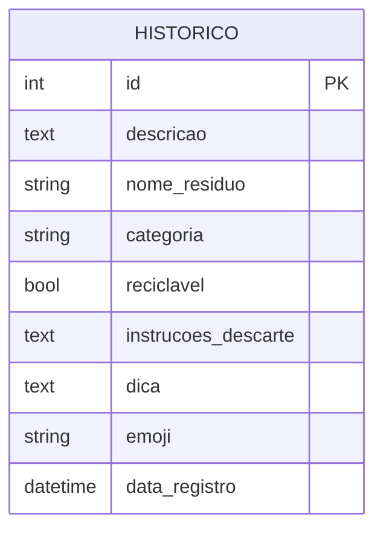

# Diagrama do Banco de Dados - DescarteIA

Uma tabela só, sem relacionamento com outra tabela.

`categoria` é salva como texto (um dos 16 valores da enumeração `Categoria`),
não como uma tabela separada - não tem necessidade de gerenciar categorias
dinamicamente, elas são fixas no código.

Na nuvem a tabela fica no PostgreSQL do Supabase. Os campos de texto longo
(`descricao`, `instrucoes_descarte` e `dica`) são `text`, sem limite de tamanho,
porque o PostgreSQL recusa textos maiores que o tamanho da coluna.
